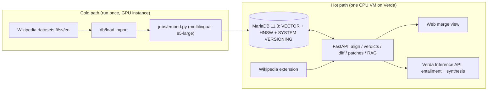

# One Verifiable Record

**Cross-language Wikipedia fact-consistency, built on MariaDB Vector + System-Versioned Tables.**
Junction 2026 · MariaDB challenge #307 ("Wikipedia Through Time")

> Wikipedia's language editions are parallel branches of the same truth.
> **One Verifiable Record is the merge tool.**

Pick an article. We decompose every imported source chunk in its fi / sv / en editions into
**atomic claims**, align them across languages with multilingual embeddings inside MariaDB, and
render a **git-diff-style merge view**:
what the editions agree on, where they contradict each other, and what one edition simply does not
know yet. Every verdict ships with **receipts**: the source passage, the revision id, and a deep
link back into Wikipedia.

## Key features

| Feature | Implementation |
| --- | --- |
| Cross-language claim alignment | Every extracted claim is searched in each other available language; dynamic predicate recall plus MariaDB vector search (`VEC_DISTANCE_COSINE`, HNSW index) over multilingual claim embeddings |
| Verdicts with receipts | `supported` / `contradicted` / `unverifiable` + evidence passage, revision id, wiki link |
| Claim provenance — "biography of a sentence" | MariaDB System-Versioned Tables (`claims`, `claim_links`, `reviews`, `suggestions`) |
| Grounded Q&A (RAG track) | The same vector index over article chunks; answers cite per-language sources |
| Human-in-the-loop review | Review console to confirm/fix verdicts; every decision is itself versioned |
| Patch generation | Per-language proposed wikitext edits / talk-page drafts, one-click export (never automated editing) |
| Wikipedia companion extension | Manifest V3 consistency badge + deep links on live Wikipedia articles |

## Architecture



* **Hot path** (one Verda CPU VM, 4–8 vCPU, 16–32 GB RAM, NVMe): MariaDB + API + web via docker-compose.
* **Cold path** (GPU instance, destroy after the run): the embedding job.
* **LLM at query time**: Verda Inference API for cross-language entailment and RAG synthesis.

See `docs/deploy-verda.md` for the full deployment runbook.

## Quick start

```bash
cp .env.example .env          # adjust credentials / Verda API key
docker compose up --build     # MariaDB + API + web

./db/load/download_datasets.sh small
pip install -r db/load/requirements.txt
python db/load/import_dump.py --data-dir db/load/data --only-shared

pip install -r jobs/requirements.txt
python jobs/embed.py --tables chunks  # CPU is fine for the small dataset
python jobs/extract_claims.py --pilot 20
python jobs/embed.py --tables claims
curl -X POST localhost:8000/api/align/Q12345
```

Claim predicates are extractor-generated canonical relations, not an application
allow-list. For existing data made with an older extractor, re-run extraction and
embedding before interpreting coverage. For example, for a selected entity:

```bash
python jobs/extract_claims.py --qids Q12345 --replace-current
python jobs/embed.py --tables claims
curl -X POST localhost:8000/api/align/Q12345
```

`--replace-current` is deliberately scoped to the selected QIDs and records the
prior system-versioned claim/link rows as history.

### On-demand Verda GPU embeddings

When `GPU_EMBED_BASE_URL` and `GPU_EMBED_TOKEN` point at the protected Verda
worker, embed only the missing current claim vectors for one page:

```bash
# Run on the app VM (or use the public web origin's /api proxy).
curl -X POST 'http://localhost:8000/api/embed/Q12345'
```

Add `?include_chunks=true` after an import to embed the page's RAG passages as
well. The API sends text batches to the GPU worker but writes vectors through
the app VM's existing MariaDB connection, so MariaDB is never exposed on the
GPU VM. The worker is intentionally QID-scoped and GPU-billed while running;
stop it with `verda vm shutdown --id <gpu-worker-id>` when it is no longer
needed.

Open http://localhost:8080 (merge view) or http://localhost:8000/docs (API reference).

### Refreshing a dataset snapshot

Imports are append-only: a changed article adds its new revision's chunks and retains
the old revision for claim receipts. The merge view and RAG read only the current
article revision. Re-run extraction, claim embedding, and alignment for refreshed
QIDs; this is what allows a corrected Wikipedia revision to resolve a finding.

For an existing database created before this behaviour, apply the one-time migration
before importing:

```bash
docker compose exec -T mariadb sh -lc 'mariadb -u"$MARIADB_USER" -p"$MARIADB_PASSWORD" wikipedia' < db/migrations/001_live_refresh.sql
docker compose exec -T mariadb sh -lc 'mariadb -u"$MARIADB_USER" -p"$MARIADB_PASSWORD" wikipedia' < db/migrations/002_open_claim_taxonomy.sql
```

## Repository layout

```
db/          schema.sql (VECTOR, HNSW, SYSTEM VERSIONING) + dataset loaders
jobs/        GPU embedding pipeline (multilingual-e5-large)
server/      FastAPI: claim alignment, verdict layers, diff engine, patches, RAG
web/         Merge-view web app (static, served by nginx)
extension/   Manifest V3 Wikipedia companion
docs/        Verda deployment guide
```

## How this uses MariaDB (challenge criteria)

* **Vector, creative use (20%)**: claims and chunks are embedded once; all cross-language matching
  and RAG retrieval are single SQL statements (`VEC_DISTANCE_COSINE` over an HNSW index). No external
  vector store, no special service: the database *is* the retrieval engine.
* **System Versioning (SVT track bonus)**: `claims`, `claim_links`, `reviews`, `suggestions` are
  system-versioned. Any verdict change keeps its full history; the "biography of a sentence"
  click-through (`FOR SYSTEM_TIME ALL`) shows what was claimed, when, and why it changed.
* **Scalability (20%)**: the identical stack runs on the small / medium / large datasets; HNSW +
  a batch embedding job keep the cold path linear. Record timings per size for the demo.
* **Real-world usefulness (20%)**: readers get a trust signal; editors get actionable, cited
  per-language patch drafts instead of vague warnings.
* **Originality (20%)**: language editions as branches — and a merge tool between them.

## Honest limits (and roadmap)

* We do **not** auto-edit Wikipedia: cross-wiki bot editing is prohibited by Wikipedia policy.
  We generate exportable patch drafts for human editors.
* A MediaWiki extension is not deployable in 48h (WMF review + community consensus). Our companion
  is a browser extension; roadmap: Toolforge hosting + user scripts.

## License

MIT
